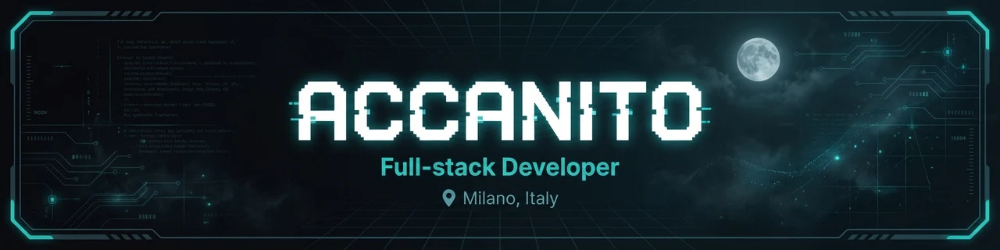
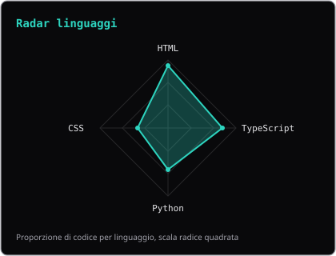
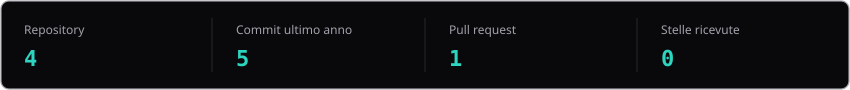
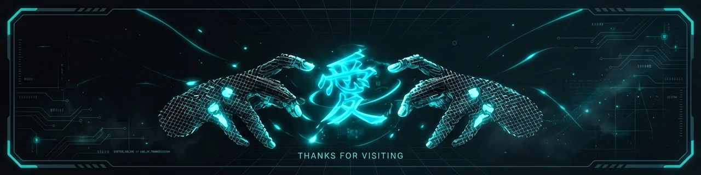

<!-- BANNER IN ALTO -->

  

<!-- ABOUT ME -->
<h3 align="center">About Me</h3>

---

I'm **[Tuo Nome]**, from Italy 🇮🇹. Scrivi qui la tua breve introduzione.

* 🚀 **Building now:** il progetto a cui stai lavorando ora
* 🌐 **Goal:** il tuo obiettivo principale
* 🤝 **Open to:** collaborazioni, progetti o freelance
* 💬 **Any questions?** Feel free to reach out!

<!-- LANGUAGES AND ACTIVITY -->
<h3 align="center">Languages and activity</h3>

---

  
  
   
  

<!-- CONTACTS -->
<h3 align="center">Contacts</h3>

---

  
  
  
  
  

<!-- BANNER IN BASSO -->

  

